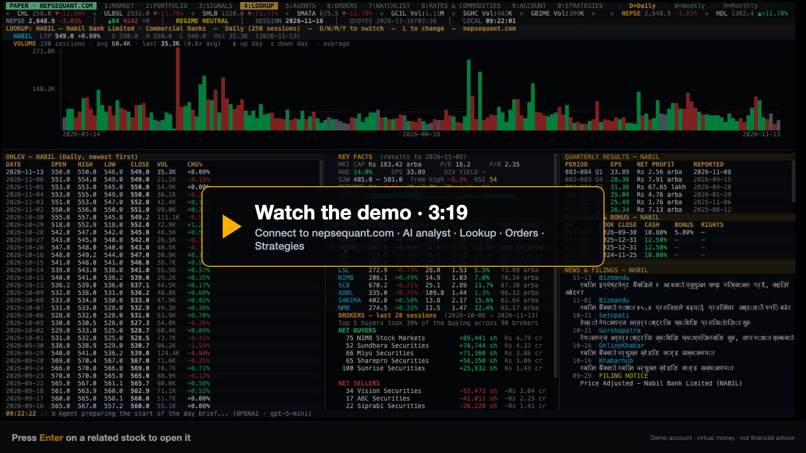
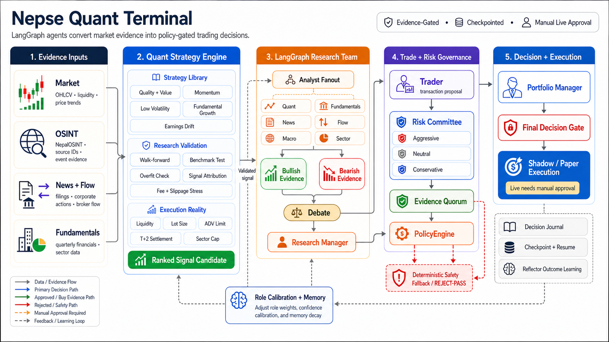

# NEPSE Quant Terminal

[](https://github.com/nlethetech/nepse-quant-terminal/actions/workflows/python-ci.yml)

[](LICENSE)

A keyboard-driven research and paper-trading terminal for the Nepal Stock Exchange (NEPSE). It runs in your terminal on macOS, Windows and Linux, works on its own, and connects to a free [nepsequant.com](https://nepsequant.com) account for one shared paper book, the website's market data, your own strategies and an AI analyst.

[](docs/media/nepse-quant-terminal-demo.mp4)

[▶ Watch the 3-minute demo](docs/media/nepse-quant-terminal-demo.mp4), one continuous take: create a key on nepsequant.com, connect the terminal, add an AI analyst, then Portfolio, Lookup, Orders, Signals, Strategies and Agents. *Recorded on a demo account: virtual money and back-dated example trades, not a track record.*

> **Paper trading only.** The terminal cannot connect to a broker or place real orders; every trade uses virtual money. It is a research and education tool, not financial advice. Please read the [disclaimer and limitations](#disclaimer-and-limitations).

---

## Contents

- [Quick start](#quick-start)
- [Connect to nepsequant.com](#connect-to-nepsequantcom)
- [What's inside](#whats-inside)
- [AI analyst](#ai-analyst)
- [Keyboard shortcuts](#keyboard-shortcuts)
- [Market data](#market-data)
- [Security and privacy](#security-and-privacy)
- [For developers](#for-developers)
- [Disclaimer and limitations](#disclaimer-and-limitations)
- [Contributing](#contributing)
- [License](#license)

---

## Quick start

### The easy way (no command line)

1. Download the repository: **Code → Download ZIP**, then unzip it (or `git clone` it).
2. Double-click the launcher for your computer:

   | System | Launcher |
   |---|---|
   | macOS | `Nepse Quant Terminal.app` (or `Launch Quant Terminal.command`) |
   | Windows | `Launch Quant Terminal.bat` |

The launcher creates a Python environment, installs what the terminal needs, downloads the market database (about 13 MB) and starts the terminal. The first start takes a few minutes; later starts are quick. If macOS blocks the launcher or something goes wrong, see [docs/EASY_LAUNCH.md](docs/EASY_LAUNCH.md).

### Manual install

Requires **Python 3.10–3.13** (3.12 recommended; 3.14 is not supported yet).

macOS and Linux:

```bash
git clone https://github.com/nlethetech/nepse-quant-terminal
cd nepse-quant-terminal
python3.12 -m venv .venv && source .venv/bin/activate
pip install -r requirements.txt
python setup_data.py                 # downloads the market database (~13 MB)
python -m apps.tui.dashboard_tui     # start the terminal
```

Windows (PowerShell):

```powershell
git clone https://github.com/nlethetech/nepse-quant-terminal
cd nepse-quant-terminal
py -3.12 -m venv .venv
.\.venv\Scripts\Activate.ps1
python -m pip install -U pip
python -m pip install -r requirements.txt
python -m scripts.ops.windows_preflight
python setup_data.py
python -m apps.tui.dashboard_tui
```

---

## Connect to nepsequant.com

Connecting is optional. On its own, the terminal keeps a local paper book and uses its local market database. Connected, it uses your [nepsequant.com](https://nepsequant.com) paper portfolio, so the website, your phone and the terminal all show the same book.

1. Sign in at [nepsequant.com](https://nepsequant.com) (free) and open **Settings → AI agents**.
2. Type a name for the key, tick **Paper trading** so the terminal can place paper orders, and press **Create key**. The key is shown once: copy it. (A key without Paper trading shows your book read-only.)
3. In the terminal's folder, save the key:

   ```bash
   ./nqt-connect login     # paste the key; it stays hidden
   ./nqt-connect status    # shows the account and whether the key can trade
   ```

4. Start the terminal: `python -m apps.tui.dashboard_tui` (or use the launcher).

| Command | What it does |
|---|---|
| `./nqt-connect login` | Save a key from nepsequant.com |
| `./nqt-connect status` | Show the linked account and the key's access |
| `./nqt-connect paper` | Print your paper portfolio |
| `./nqt-connect real` | Print your real portfolio (read-only) |
| `./nqt-connect logout` | Remove the key and return to the local paper book |

**While connected:**

| Area | What changes |
|---|---|
| Portfolio, Orders, Trades | Show your nepsequant.com paper book, refreshed every 30 seconds. |
| Placing orders | Orders go to the website's paper simulator. Leave the price empty for a market order, or type one for a limit order. The website applies NEPSE's rules (trading hours, Rs 0.10 ticks, price band, T+2 settlement, fees and capital gains tax), so a fill in the terminal is the same fill you see on the website. |
| Lookup | Shows nepsequant.com's page for a stock (see [What's inside](#whats-inside)). |
| Strategies | Lists the strategies you built on nepsequant.com: Lab rule sets, signal blends and saved Screener screens. Assign one to see its picks; **AUTO** trades it on your paper book while the terminal is open and NEPSE is trading. Auto-trade sends at most 8 orders a minute and only sells what it bought. |
| Broker panels | The Signals tab's broker panels are computed on your computer from the website's floorsheet, so no local scraper is needed. |
| AI analyst | Reads the website's market briefing and can look up prices, history, company news and filings while it answers. |

To keep the local paper book while a key is saved, start the terminal with `NQT_SHARED_BOOK=0`.

---

## What's inside

| Key | Tab | What you get |
|---|---|---|
| `1` | Market | Gainers, losers, volume leaders, 52-week extremes, live quotes and a sector heatmap |
| `2` | Portfolio | Holdings, realised and unrealised P&L, NAV history, sector concentration, drawdown and alpha against NEPSE |
| `3` | Signals | Today's picks from your strategy, plus broker-flow panels (broker floor and top brokers by net quantity) |
| `4` | Lookup | Any stock or the NEPSE index: volume chart (green up days, red down days), daily, weekly and monthly prices, key facts (market cap, P/E, P/B, ROE, yield, 52-week range), related stocks in the same sector, quarterly results, dividends and bonus shares, news and exchange filings, and 20-session broker flow |
| `5` | Agents | AI analyst chat, a review of today's picks, and automatic market briefs |
| `6` | Orders | Paper order ticket, today's order book and order history |
| `7` | Watchlist | Your stocks and macro items in one table |
| `8` | Rates & Commodities | Kalimati produce prices, forex rates and global rates and prices |
| `9` | Account | Paper accounts, account setup and MeroShare import |
| `0` | Strategies | Connected: your nepsequant.com strategies. Local: build, backtest and assign your own strategies |

Also included:

- **Backtesting and validation:** backtests on more than six years of NEPSE prices, with walk-forward replay, Monte Carlo, CSCV/PBO overfitting checks, the deflated Sharpe ratio and a random-baseline comparison.
- **Local auto-trading engine:** when not connected, each paper account can run its own strategy in the background, with holding periods, stop-losses, trailing stops and a market-regime filter.
- **Gold hedge overlay:** a gold and silver risk regime that scales how much capital the engine deploys.
- **MeroShare import:** start a paper account from your MeroShare "My Shares Values.csv" export.

---

## AI analyst

The Agents tab works with a free local model (Ollama) or with your own OpenAI or Anthropic (Claude) API key. Set it up once from the terminal's folder:

```bash
./nqt-connect ai setup     # choose ollama, openai or anthropic; paste the key (hidden)
./nqt-connect ai status    # provider, model and whether a key is saved (never the key itself)
./nqt-connect ai off       # delete saved keys and go back to local Ollama
```

| Provider | Default model | Cost | You need |
|---|---|---|---|
| `ollama` | `llama3` (or any model you have installed) | Free, runs on your computer | [Ollama](https://ollama.com), e.g. `ollama pull llama3.2` |
| `openai` | `gpt-5-mini` | Billed to your OpenAI key | An OpenAI API key |
| `anthropic` | `claude-opus-5-5` (lower cost: `claude-haiku-5-5`) | Billed to your Anthropic key | An Anthropic API key |

What the analyst does:

- **Knows your context:** your watchlist, your paper book's holdings and recent trades, and your assigned strategy with today's picks.
- **Looks things up while it answers:** prices and key facts, price history, a company's news and filings, and the day's movers. Lookups are read-only (at most six per answer) and come from nepsequant.com when connected, otherwise from your local database. `NQT_AGENT_TOOLS=0` turns them off.
- **Posts short briefs:** once a day and, on trading days, at 10:30, 13:00 and 15:15 Nepal time: what moved in your names and why, stocks that moved on news, and names worth researching. `/brief` runs one now; `/proactive off` stops them.
- **Follows the same rules on every provider:** paper trading only, the same analysis format, and the trade-approval veto.

Switch provider or model at any time in the Agents tab: `/agent openai`, `/agent anthropic claude-haiku-5-5`, `/agent ollama llama3.2`, or `/model <name>`. The header shows what is answering.

Costs are billed to your own key; the terminal keeps requests small (recent chat turns only, trimmed context, capped answer length, cached system prompt).

<details>
<summary><b>Ollama step by step</b></summary>

1. Install Ollama: `brew install ollama` (macOS) or `curl -fsSL https://ollama.com/install.sh | sh` (Linux). On Windows, use the installer from [ollama.com](https://ollama.com).
2. Download a model that fits your memory:

   | Model | Memory | Command |
   |---|---|---|
   | `llama3` | 8 GB | `ollama pull llama3` |
   | `mistral` | 8 GB | `ollama pull mistral` |
   | `phi3` | 4 GB | `ollama pull phi3` |
   | `qwen2` | 8 GB | `ollama pull qwen2` |
   | `llama3:70b` | 40 GB | `ollama pull llama3:70b` |

3. Start the server: `ollama serve` (it listens on `http://localhost:11434`; set `OLLAMA_HOST` to use another machine).
4. Start the terminal, open the Agents tab (`5`) and press `A` to analyse your picks, or type a question.

</details>

<details>
<summary><b>Other backends: Gemma 4 on Apple Silicon, Claude CLI</b></summary>

- **Gemma 4 (MLX, Apple Silicon only):** `pip install mlx-vlm`, then `/agent gemma4_mlx` in the Agents tab. The model (about 3 GB) downloads on first use.
- **Claude CLI:** install Claude Code (`npm install -g @anthropic-ai/claude-code`), run `claude login`, then `/agent claude`.

The chosen backend is saved in `data/runtime/agents/active_agent.json`. `OPENAI_BASE_URL` points the `openai` provider at any OpenAI-compatible server.

</details>

---

## Keyboard shortcuts

| Key | Action |
|---|---|
| `1`–`9`, `0` | Switch tabs (see [What's inside](#whats-inside)) |
| `L` | Look up a stock |
| `D` `W` `M` `Y` `I` | Lookup chart: daily, weekly, monthly, yearly, intraday |
| `Enter` | On a related stock or mover in Lookup: open it |
| `A` | Run the AI analysis of your picks |
| `R` | Refresh market data |
| `F` | Reload signals |
| `=` / `-` | Add the current stock to, or remove it from, the watchlist |
| `/` or `Ctrl+P` | Go to anything (command palette) |
| `Q` | Quit |

---

## Market data

`python setup_data.py` downloads a pre-built database (about 13 MB): daily prices for every NEPSE symbol, quarterly earnings, corporate actions and benchmark history. The database is a snapshot, so keep it current for accurate signals and backtests:

```bash
python scripts/ingestion/deterministic_daily_ingestion.py   # daily update, after the market closes
python setup_data.py --scrape --days 90                     # refill the last 90 days (~5 minutes)
python setup_data.py --scrape                               # full historical rebuild (30–60 minutes)
```

When the terminal is connected to nepsequant.com, Lookup, the broker panels and the analyst's market briefing come from the website and need no local updates.

NEPSE trades **Monday to Friday** by default (it moved from a Sunday–Thursday week in April 2026); set `NEPSE_TRADING_WEEK=sun_thu` for the old calendar. Holding periods are counted in trading days.

---

## Security and privacy

- **Keys stay on your computer.** The nepsequant.com key is saved in `~/.config/nepse-quant-terminal/credentials.json` and AI keys in `ai.json` in the same folder, both readable only by you. Neither is ever displayed.
- **Each key goes only where it belongs.** The nepsequant.com key is sent only to `https://nepsequant.com` over HTTPS and never through a redirect; AI keys are sent only to their provider. Keys are removed from error messages and from anything an AI model sees.
- **Revocable at any time.** Revoke a key on nepsequant.com under Settings → AI agents, or run `./nqt-connect logout`.
- **No real money.** Nothing in the terminal can reach a broker.

---

## For developers

### Architecture

```
┌──────────────────────────────────────────────────────────────┐
│ Textual TUI · apps/tui/dashboard_tui.py · 10 tabs · keyboard │
└───────┬──────────────────────┬───────────────────────┬───────┘
        │                      │                       │
┌───────▼───────┐   ┌──────────▼──────────┐   ┌────────▼──────────┐
│ Local market  │   │ Paper trading       │   │ nepsequant.com    │
│ database      │   │ paper_execution.py  │   │ (when connected)  │
│ backend/market│   │ tui_trading_engine  │   │ apps/cli/connect  │
└───────┬───────┘   └──────────┬──────────┘   │ apps/tui/io/      │
        │                      │              │   website_*.py    │
┌───────▼──────────────────────▼───────┐      └───────────────────┘
│ Signal engine · simple_backtest.py   │
│ volume · quality · low_vol ·         │
│ mean_reversion · xsec_momentum ·     │
│ quarterly_fundamental · satellite    │
└──────────────────────────────────────┘
```

| Component | Location | Role |
|---|---|---|
| Terminal UI | `apps/tui/` | Tabs, panels, keyboard handling (Textual) |
| nepsequant.com link | `apps/cli/connect.py`, `apps/tui/io/website_*.py` | Keys, shared paper book, lookup, strategies, floorsheet |
| Website auto-trader | `apps/tui/io/strategy_autotrader.py` | Trades an assigned website strategy on the paper book |
| Broker panels engine | `native/nqt_floor` (Rust, optional), `apps/tui/io/floor_metrics.py` | Broker-flow metrics; the Python version gives identical results |
| Paper execution | `backend/trading/paper_execution.py` | Account-scoped paper orders and fills |
| Local auto-trading engine | `backend/trading/tui_trading_engine.py` | Per-account strategy loop, regime filter, stops |
| Signal engine and backtests | `backend/backtesting/simple_backtest.py` | Signal generation and the backtest runner |
| Strategy registry | `backend/trading/strategy_registry.py` | Load, save and assign strategies |
| AI analyst | `backend/agents/` | Providers (Ollama, OpenAI, Anthropic), lookups, briefs |
| Paper agent graph | `backend/nepse_agents/` | Evidence-gated research, debate, risk and portfolio workflow (paper only) |
| Validation | `validation/` | Walk-forward, Monte Carlo, CSCV/PBO, deflated Sharpe, random baseline |
| Trading calendar | `backend/quant_pro/nepse_calendar.py` | Trading days and public holidays |



### Signals

Each signal scores symbols from 0 to 1 on a given date; scores are combined with weights that depend on the market regime (a rolling 60-day NEPSE return classifies bull, neutral or bear). By default signals fire every five trading days, which avoids overtrading a thin market.

| Signal | Logic |
|---|---|
| `volume` | Volume breakout above the 20-day average with price confirmation |
| `quality` | ROE, debt-to-equity and earnings stability |
| `low_vol` | Low 60-day realised volatility with positive momentum |
| `mean_reversion` | RSI oversold and distance below the 52-week high |
| `xsec_momentum` | Cross-sectional 6-month-minus-1-month momentum |
| `quarterly_fundamental` | EPS and revenue growth from quarterly filings |
| `satellite_hydro` | Hydropower signals from rainfall data |

To add a signal, implement a function in `backend/backtesting/simple_backtest.py`, for example `generate_my_signal_at_date(symbols, date, prices_df)`, that returns a list of `{"symbol": str, "score": float 0–1, "reason": str}`. Register it in the `SIGNAL_MAP` dict inside `run_backtest()` and add `"my_signal"` to a strategy's `signal_types`.

### Backtests and validation

```python
from backend.backtesting.simple_backtest import run_backtest

results = run_backtest(
    start_date="2020-01-01",
    end_date="2025-12-31",
    signal_types=["volume", "quality", "low_vol", "mean_reversion", "xsec_momentum", "quarterly_fundamental"],
    holding_days=40,
    max_positions=5,
    stop_loss_pct=0.12,
    trailing_stop_pct=0.15,
    use_regime_filter=True,
    initial_capital=1_000_000,
)
```

```bash
python -m validation.run_all                      # full battery on the bundled C5 baseline
python -m validation.run_all --fast               # quicker run with fewer simulations
python -m validation.run_all --signals volume quality   # an ad-hoc signal set
python -m validation.run_all --holding-days 60          # override one parameter on top of C5
python -m validation.run_all --config legacy            # the older 3-signal configuration
```

The suite prints a GO / NO-GO verdict and writes JSON and PDF reports to `reports/validation/`. The CSCV/PBO test and the alpha-versus-beta benchmark are reported but do not gate the verdict; read them anyway. See [docs/VALIDATION_METHODOLOGY.md](docs/VALIDATION_METHODOLOGY.md) for what each test does and does not prove.

### Strategies

A local strategy is a JSON file in `data/strategy_registry/`:

```json
{
  "id": "my_strategy",
  "name": "My Strategy",
  "config": {
    "signal_types": ["volume", "quality", "xsec_momentum"],
    "holding_days": 40,
    "max_positions": 5,
    "stop_loss_pct": 0.12,
    "trailing_stop_pct": 0.15,
    "use_regime_filter": true,
    "regime_max_positions": {"bull": 5, "neutral": 4, "bear": 1},
    "sector_limit": 0.35
  }
}
```

Without a nepsequant.com link, build strategies in the Strategies tab (**N NEW**, toggle signals, set parameters, **SAVE**) and assign one to a paper account with **→ ACTIVE ACCT**. Local paper accounts live in `data/runtime/accounts/account_N/` (positions, trade log, NAV history, cash and watchlist).

### Tests

```bash
python -m pytest tests/
```

The tests run offline in a throwaway home folder: they never read your real keys or settings, and any attempt to reach the internet fails the run. CI runs them on macOS, Windows and Ubuntu.

### Optional: Rust engine for the broker panels

The broker panels run in Python by default. An optional Rust module computes the same numbers about five times faster:

```bash
pip install maturin && maturin develop --release -m native/nqt_floor/Cargo.toml
```

Set `NQT_FLOOR_ENGINE=python` to ignore it.

---

## Disclaimer and limitations

This software is for research and education. It is **not financial advice** and nothing in it is a recommendation to buy or sell any security. It cannot place real orders. Past performance, simulated or historical, does not indicate future results.

Backtests have limits that make headline returns look better than real trading would:

- **In-sample figures.** The bundled C5 baseline's historical +88% return (Sharpe about 2.2, against NEPSE +27%) comes from a parameter sweep. It is not corrected for the number of variants tried, and the repository includes nothing that reproduces it as a forward-tested result.
- **No slippage in the base engine.** `run_backtest` charges fees but fills at the open with no slippage; slippage is estimated only in the validation suite (`validation/slippage.py`).
- **Limit-locked days still fill.** Entry prices are clamped to the ±10% circuit band, so a stock locked at its limit still "fills" at a price that often could not be traded.
- **Survivorship bias.** The universe is the set of symbols in the current database; delisted and suspended stocks are not reconstructed point-in-time.

Read the deflated Sharpe ratio, the random-baseline percentile and the benchmark comparison from `python -m validation.run_all` rather than the headline return. The terminal is still being improved toward parity with [nepsequant.com](https://nepsequant.com); for the most complete experience today, use the website.

---

## Contributing

Bug reports and pull requests are welcome. Please run `python -m pytest tests/` before opening a pull request, and include evidence for any change to how figures are calculated. By contributing, you agree that your contribution is licensed under the AGPL-3.0 (see [License](#license)).

Thanks to everyone who has contributed, including Saurab Shrestha for the EPS annualization fix (#32) and Prabesh Aryal for the Windows compatibility fixes.

---

## License

Copyright (C) 2026 nlethetech and contributors.

NEPSE Quant Terminal is free software, licensed under the **GNU Affero General Public License v3.0** (see [LICENSE](LICENSE)). You may use, study, change and share it. If you distribute a modified version, or run one for other people over a network, you must make its complete source code available under the same licence.

Earlier versions of this repository were published under the MIT License. Copies obtained under those terms, and contributions made under them, remain available under MIT.

The nepsequant.com website, its data and its services are separate from this repository and are not covered by this licence.
